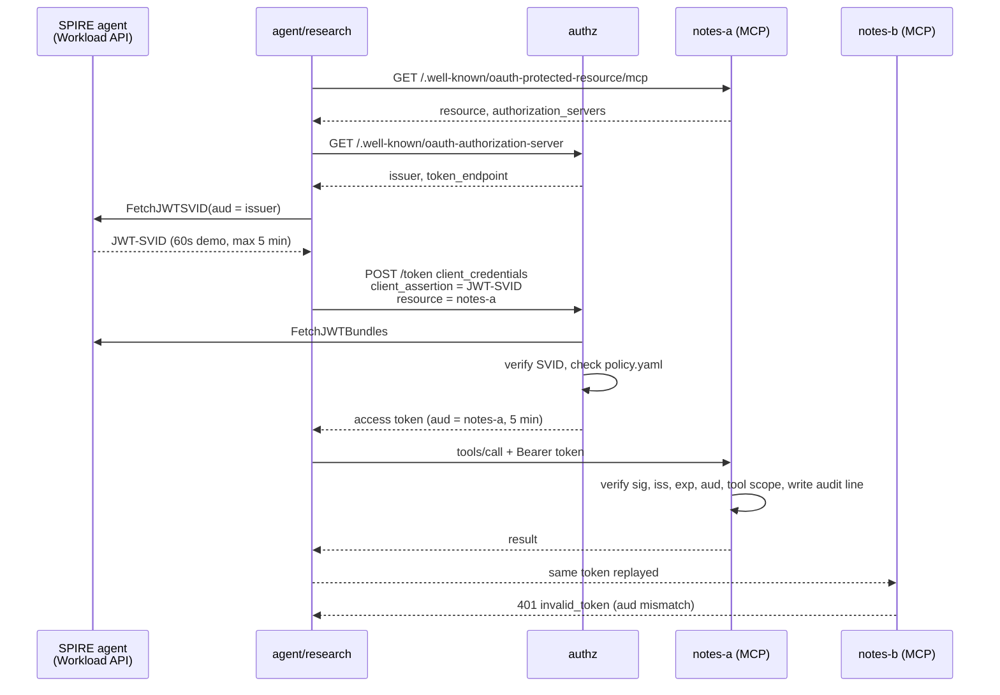

# mcp-svid-auth

A checked proof of concept: an AI agent exchanges its SPIFFE workload identity for a short-lived, audience-bound MCP access token. The demo shows both enforced security boundaries and the failures identity alone cannot prevent.

Documentation: https://tanya-ok.github.io/mcp-svid-auth/

## Problem

MCP client configs often hold long-lived static keys:

```json
{ "env": { "NOTES_API_KEY": "sk-live-..." } }
```

| Issue with static keys | Effect |
|---|---|
| Long-lived | A leaked key works until someone rotates it by hand |
| Not bound to a workload | Any process that reads the file can use it |
| Not bound to a server | One key often opens several servers |
| No per-caller identity | Audit logs cannot say which agent acted |

## What this POC shows

| Claim | Where |
|---|---|
| An agent gets a short-lived access token using only its JWT-SVID | `authz.py`, [draft-ietf-oauth-spiffe-client-auth](https://datatracker.ietf.org/doc/draft-ietf-oauth-spiffe-client-auth/) |
| Tokens are bound to one MCP server via the RFC 8707 `resource` parameter | `authz.py`, `policy.py` |
| A token issued for server A is rejected by server B | `mcp_server.py`, `test_token_for_a_is_rejected_by_b` |
| Scopes are enforced per tool, with a 403 `insufficient_scope` challenge. Tools without a declared scope are denied. | `ToolScopeGuard`, `build_mcp` |
| Decisions are hash-chained; a separately trusted terminal checkpoint detects suffix deletion and chain replacement. Without a checkpoint, `mcp-svid-audit-verify` detects edits but not deletion of lines from the end | `audit.py` |
| The MCP server never forwards the incoming token. With an upstream it uses its own token | `Upstream` in `mcp_server.py`, `test_no_passthrough.py` |
| A stdio MCP server can start with a refreshed short-lived token instead of a static key | `stdio_wrapper.py` |

Targets the [MCP authorization spec, revision 2026-07-28](https://modelcontextprotocol.io/specification/2026-07-28/basic/authorization) (checked 2026-10-04): Protected Resource Metadata (RFC 9728), resource indicators (RFC 8707), audience validation, no token passthrough.

Client authentication implements the JWT-SVID exchange from [draft-ietf-oauth-spiffe-client-auth-02](https://datatracker.ietf.org/doc/draft-ietf-oauth-spiffe-client-auth/): assertion type `urn:ietf:params:oauth:client-assertion-type:jwt-spiffe`, advertised as `spiffe_jwt` in `token_endpoint_auth_methods_supported`. This is a supported subset, with a deliberate local Workload API bundle-lookup deviation. See the [compatibility matrix](docs/compatibility.md) for draft status, generic OAuth differences and the independently checked TypeScript adapter.

## Architecture



## Components

| Module | Command | Role |
|---|---|---|
| `authz` | `mcp-svid-authz` | Token endpoint. JWT-SVID client assertion in, audience-bound JWT access token out. Publishes JWKS and RFC 8414 metadata. |
| `mcp_server` | `mcp-svid-notes` | MCP server over Streamable HTTP. Tools `notes.search` (`notes:read`) and `notes.write` (`notes:write`); with `--upstream-resource` also `notes.search_upstream` (`notes:read`), which calls another MCP server with the server's own token. |
| `agent_client` | `mcp-svid-agent` | Discovers the authorization server, refuses it unless it is on the `--trusted-issuer` allowlist, fetches its SVID, gets a token, calls tools. `--steal-token` replays a token against another server. |
| `stdio_wrapper` | `mcp-svid-stdio` | Starts a local stdio MCP server with `MCP_ACCESS_TOKEN_FILE` (0600, refreshed). Fails closed on expiry. `--export-token-env` also sets `MCP_ACCESS_TOKEN` and stops the child when it expires (weaker, see below). |
| `deploy/` | `make demo` | SPIRE server and agent 1.15.3 (pinned by digest), registration entries, the services, eighteen asserted Kubernetes scenarios and a safe verdict report. |

Token request, as sent by the agent:

| Parameter | Value |
|---|---|
| `grant_type` | `client_credentials` |
| `client_assertion_type` | `urn:ietf:params:oauth:client-assertion-type:jwt-spiffe` |
| `client_assertion` | JWT-SVID, `aud` = authz issuer only, `iat` required, `exp - iat` at most 300s (`--max-svid-lifetime`) |
| `client_id` | the SPIFFE ID (optional, must match the SVID `sub`) |
| `resource` | canonical URI of the MCP server (required) |
| `scope` | required, single-space separated, must be a subset of the policy grant |

Repeated parameters are rejected with `invalid_request`. Error descriptions are fixed strings; audit diagnostics retain exception class names, not exception text. Unverified subjects and SVID IDs are hashed before logging.

The MCP server accepts only access tokens with header `typ` `at+jwt`, algorithm ES256, and claims `iss`, `sub`, `aud`, `exp`, `iat`, `scope`. Request bodies are capped at 1 MiB (413). Bodies that are not valid JSON-RPC get 400.

## Quickstart

The single-repository path needs only Python 3.12+ and [uv](https://docs.astral.sh/uv/), plus Node 26+ and npm for the interoperability check. It uses runtime local keys instead of SPIRE and contacts no external service after dependencies are installed.

```sh
uv sync --locked
make check      # ruff, mypy strict, pytest (offline, no SPIRE needed)
(cd examples/typescript-client && npm ci --ignore-scripts --no-audit --no-fund)
make interop    # local authz and notes server on loopback, driven by the TypeScript MCP SDK
make package    # local wheel + source archive; no publication
```

`make interop` is the local end-to-end demo without the lab: discovery, JWT-SVID exchange, MCP initialization, scoped tool listing, an allowed read and a denied write. Offline tests use a local key as a stand-in for SPIRE (`LocalSvidIssuer`). `mcp-svid-authz --static-jwks` accepts a JWKS file for the same purpose.

Optional local anonymization denylist: put one term per line in `tests/denylist.txt` (git-ignored). `tests/test_no_identifiers.py` then fails on any match in the tree or history.

### Full Kubernetes lab (requires unpublished components)

The integrated lab is not reproducible from this repository alone. It needs a sibling checkout of `mcp-spiffe-bridge`, which is not yet published, and of [`hipaa-fhir-mcp`](https://github.com/tanya-ok/hipaa-fhir-mcp). On macOS it also needs [Lima](https://www.cncf.io/projects/lima/) 2.2.1+. The demo scenarios below were recorded in that lab. See [shared security lab](docs/kubernetes-lab.md) and [CNCF runtime](docs/runtime.md).

```sh
make runtime-up   # dedicated Lima Kubernetes/containerd VM: 2 CPUs, 4 GiB memory
make demo         # fresh lab stack; includes real expiry and negative cases
make down
make runtime-stop # release VM CPU/memory only when no sibling project needs it
```

For the lab's read-only interface, run `make ui` and open [Security lab](http://127.0.0.1:4466/c/main/security-lab). It shows services, trust relationships, permissions, safe audit outcomes and the latest demo verdicts. See [Headlamp interface](docs/headlamp-ui.md) for access limits and shutdown commands.

`make down` removes only owned Security Lab resources. If another project shares
this VM, retain the VM instead of running `make runtime-stop`. IT GRC (`it-grc`,
not yet public) runs CISO Assistant Community edition in its own Lima VM, not in
this lab, and takes the lab's demo report as its input.

## Demo scenarios

Each scenario asserts its outcome. An unexpected exit, missing evidence or wrong result makes `make demo` fail. It writes a credential-free report to ignored `deploy/.data/demo-report.json`; the expiry probe uses 60-second SVIDs and includes the 30-second validation leeway. See [demo details](docs/demo.md).

| # | Caller | Target | Expected |
|---|---|---|---|
| 1 | `agent/research` | notes-a | token with `notes:read notes:write`, both tools allowed |
| 2 | `agent/research` | notes-b | token with `notes:read`, `notes.write` gets 403 `insufficient_scope` |
| 3 | `agent/intruder` | notes-a | valid SVID, not in `policy.yaml`, token request fails with `unauthorized_client` |
| 4 | `agent/research` | token for notes-a sent to notes-b | 401 `invalid_token`, audit reason `InvalidAudienceError` |
| 5 | `agent-impostor` pod with the research label and another ServiceAccount | notes-a | gets the intruder identity; token request denied |
| 6 | `agent/research` | notes-rogue, whose PRM names `http://rogue-as:8100` | `issuer_refused`, no SVID fetched (LS-3) |
| 7 | `agent/research`, one JWT-SVID posted twice to `/token` | authz | two tokens under `allow-reuse-within-lifetime` (LS-9) |
| 8 | `agent/research` calls `notes.search_upstream` | notes-a, which calls notes-b | notes-b audits `mcp/notes-a`, not the caller; scenario 4 is the forwarding variant (LS-4) |
| 9 | `agent/research`, grant for notes-b removed while authz runs | notes-b | `invalid_target` after the next policy reload (LS-8) |
| 10 | Deterministic injected write request | notes-a | read-only token denied; read-write token succeeds: identity does not determine intent |
| 11 | `agent/research` after restart and planned rotation | notes-a | restart key accepted, then prepublished rotation preserves old and new tokens during overlap (LS-10) |
| 12 | Research workload through initial SVID expiry | authz and notes-a | renewed SVID remains usable; expired original assertion refused |
| 13 | One SVID used twice under default strict mode | authz-strict | first token issued, second exchange denied |
| 14 | Audit capture, then delete its final record | local verifier | complete chain passes; deletion fails against saved checkpoint |
| 15 | Research workload with SPIRE mTLS and OAuth | FHIR service | Three tools succeed; wrong audience, missing bearer and bad/unknown requests denied |
| 16 | Intruder with valid SPIRE certificate | FHIR bridge | SPIFFE caller allowlist denies access |
| 17 | Workload without client certificate | FHIR bridge | TLS handshake denied |
| 18 | FHIR audit checker | Service log | One record per invocation, verified caller, data minimization |

Audit line example:

```json
{"record_id":"5f0c9a53-2a8e-4d0b-9a57-0f3e2f6d1c44","parent_record_id":"b1d7e0a2-6c1f-4e89-8f0e-2d4c7a9b3e51","prev_hash":"3b9f0c2e8d7a41f6b5e0c9d8a7f6e5d4c3b2a1908f7e6d5c4b3a29180f7e6d5c","timestamp":"2026-09-26T18:07:11.742+00:00","component":"mcp_server:notes-b","spiffe_id":"spiffe://example.org/agent/research","tool":"notes.write","decision":"deny","reason":"insufficient_scope: needs notes:write"}
```

Denials record unverified subjects as `unverified:sha256:<digest prefix>`. A checkpoint must be retained independently of the log writer; see [audit integrity](docs/audit.md).

## Threat model notes

| Threat | Mitigation here | Gap |
|---|---|---|
| Static key leak | No static keys. Access tokens live 5 min; SVID maximum is 5 min, with 60s SVIDs in the demo. | A stolen access token works until expiry. |
| Token replay to another server | `aud` bound to one resource. Each server checks `aud` equals its own URI. | None within one issuer. |
| JWT-SVID replay to authz | SVID `aud` must be the issuer only. Maximum SVID lifetime 5 min; demo TTL 60s. Default `--svid-replay reject`: `jti` required, each `(sub, jti)` accepted once. | The container demo runs `allow-reuse-within-lifetime` because the SPIRE 1.15.3 agent re-serves cached SVIDs; there a stolen SVID mints tokens until it expires. See [docs/security.md](docs/security.md#jwt-svid-replay-tracking). |
| SVID harvesting by a malicious resource | The agent mints SVIDs only for issuers on its `--trusted-issuer` allowlist. An issuer named in Protected Resource Metadata that is not on the list is refused, and logged as `issuer_refused`, before any request to it and before any SVID fetch. Exact match after scheme, host and default port normalization; no prefix match. | The allowlist is per process, not per resource. |
| Discovery SSRF | Every URL the agent fetches or sends a credential to (resource, issuer, `token_endpoint`, tool call) must be `https` and resolve only to public addresses. Refused URLs are logged as `url_refused` and get no request. | `--allow-http` and `--allow-private-network` turn the checks off for dev; the container demo needs both. The default transport connects to a checked numeric address, preserves Host and TLS hostname verification, separates connection pools by original origin and ignores proxy environment variables. Custom HTTP factories must provide equivalent protection. |
| Workload impersonation | SPIRE Kubernetes attestor binds identity to namespace and ServiceAccount. Copied labels do not suffice. | Cluster operators and anyone allowed to use that ServiceAccount can assume its identity. |
| Over-broad access | Allowlist per SPIFFE ID, resource and scope. Per-tool scope check. Policy reloaded on SIGHUP or file change. | Policy is a local file. No versioning or review flow. Issued tokens outlive a revoked grant by up to 300s. |
| Confused deputy | Server never forwards the incoming token. An upstream call uses the server's own SVID-based token (`notes.search_upstream`), tested in `test_no_passthrough.py`. | No delegation chain: the upstream sees the relay, not the original caller. |
| Algorithm confusion | SVIDs: asymmetric algorithms only, `alg=none` rejected. Access tokens: ES256 only, `typ` `at+jwt`. Key selected by `kid` from a trusted key set. | |
| Stale token in a stdio child | Token passed by 0600 file, refreshed. Wrapper deletes it and stops the child on expiry. With `--export-token-env` the child is stopped when the exported token expires. | `--export-token-env` values are visible in the process environment to the same UID. |
| Supply chain | Dependency majors bounded, images pinned by digest, `uv.lock` committed. | `httpx2` is a transitive dependency of `mcp` 2.x. On PyPI it is owned by Pydantic Services Inc., source github.com/pydantic/httpx2, uploaded via Trusted Publishing (checked 2026-09-26). |

## Non-goals

- Not production software. No HA or distributed rate limits; planned in-process key rotation and local cost budgets only. Plain HTTP inside the demo network.
- Not a replacement for an MCP gateway such as agentgateway. It shows the token flow a gateway could implement.
- No user delegation. The agent acts as itself (`client_credentials`). No token exchange or `act` claim chain yet.
- The authorization server accepts JWT-SVID client assertions only. The shared FHIR transport also uses X.509-SVID mTLS. No WIT-SVID client authentication.
- The default Kubernetes lab is single-node and synthetic. Podman compatibility commands were retired on 2026-10-13. See [shared lab limits](docs/kubernetes-lab.md#trust-boundary-and-remaining-work).
- No `jti` replay tracking for access tokens.
- The container demo accepts JWT-SVID reuse within the SVID lifetime (`--svid-replay=allow-reuse-within-lifetime`). The SPIRE 1.15.3 agent returns the same cached SVID, with the same `jti`, on repeated fetches before renewal.

## Status

The dated [publication validation](docs/publication.md) records the checks, artifacts and remaining proof-of-concept limits. Validation runs locally; no release, package upload or deployment is part of it.

| Item | State |
|---|---|
| Offline checks | Pass on 2026-10-13: 537 tests on Python 3.12 and 3.13 after retiring the Podman backend and adding runtime migration checks, lint, formatting, strict types, generated docs and strict documentation build; source/history credential checks have no unresolved findings; see the exact packet-hash false positive in the portfolio readiness record |
| Kubernetes/containerd integration | Pass on 2026-10-13: fresh rebuild, all 18 scenarios and final scoped teardown. Planned signing rotation preserved old/new tokens; three real SPIRE fetches returned one cached assertion with jti. CISO namespace UID and shared VM preserved. See [rotation evidence](docs/auth-cost-rotation.md) |
| Headlamp interface | Namespace-scoped browsing fixed on 2026-10-20: fresh-browser Pods, Deployments and Services passed in an isolated VM, with live 403/405 negative checks and all 18 security scenarios. RBAC unchanged. A combined physical-passkey/manual resource check after this fix is still pending. See [interface and boundaries](docs/headlamp-ui.md) |
| Optional ZITADEL identity | Pass: 11 real synthetic WebAuthn/OIDC checks, 4 closed Google setup checks and full scoped lifecycle on 2026-10-06. The recovery cycle sampled at most 1858.1 MiB guest use including native startup. Real Google login and physical enrollment remain unverified. See [identity boundaries](docs/passwordless-identity.md) |
| Historical Podman validation | Retired on 2026-10-13; the 2026-10-05 result remains historical evidence only |
| Default strict replay mode | Live comparison: first exchange succeeds, second is denied. Normal demo explicitly accepts cached SVID reuse |
| Independent TypeScript MCP SDK | SDK 1.32.1 with explicit JWT-SVID adapter: discovery, exchange, initialize, scoped listing and read verified; added write denial checked separately |
| Audit completeness | Terminal checkpoint supported; its protection requires separate trusted storage |
| Publication packages | Local wheel and source archive, license and contents verified; never uploaded |

## License

Apache-2.0. See [LICENSE](LICENSE) and [NOTICE](NOTICE).

## Development review orchestration

The [local Codex and Claude review workflow](docs/quorum.md) records source snapshots, independent research, objections and explicit task selection through MCP. A [synthetic walkthrough](docs/quorum-demo/index.html) demonstrates the process without model calls. Model agreement is a proposal, not proof of correctness.
