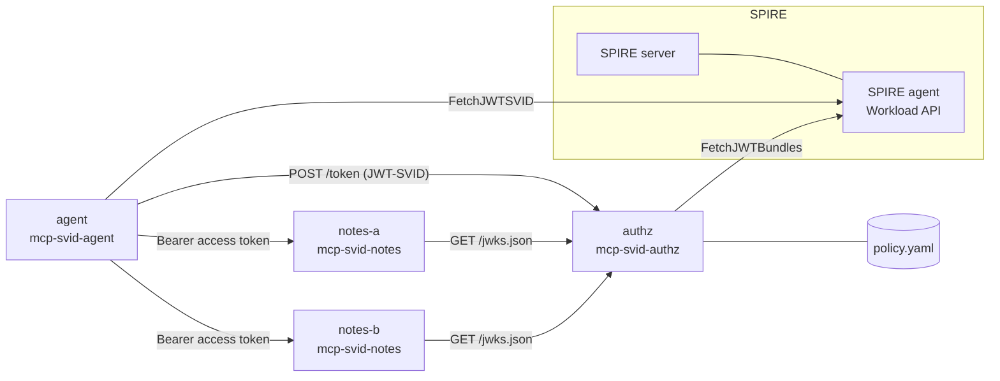
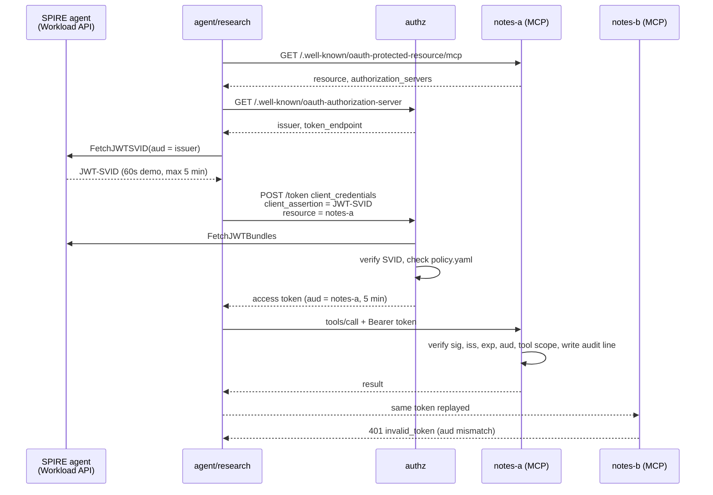
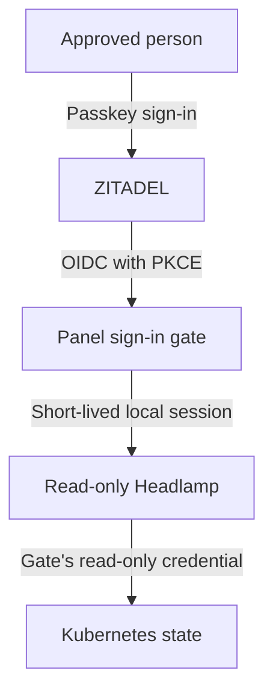

# Architecture

## Components



| Module | Command | Role |
|---|---|---|
| `authz` | `mcp-svid-authz` | Token endpoint. JWT-SVID client assertion in, audience-bound JWT access token out. Publishes JWKS and RFC 8414 metadata. |
| `mcp_server` | `mcp-svid-notes` | MCP server over Streamable HTTP. Tools `notes.search` (`notes:read`) and `notes.write` (`notes:write`); with `--upstream-resource` also `notes.search_upstream` (`notes:read`), which calls another MCP server with the server's own token. |
| `agent_client` | `mcp-svid-agent` | Discovers the authorization server, refuses it unless it is on the `--trusted-issuer` allowlist, fetches its SVID, gets a token, calls tools. Refuses non-https and non-public URLs unless relaxed for dev. `--steal-token` replays a token against another server. |
| `stdio_wrapper` | `mcp-svid-stdio` | Starts a local stdio MCP server with a refreshed token file. See [stdio wrapper](stdio-wrapper.md). |
| `policy` | none | Allowlist of SPIFFE ID, resource and scopes. |
| `audit` | `mcp-svid-audit-verify` | One hash-chained JSON line per decision, to a file or stderr, and the chain verifier. |
| `spiffe_keys` | none | JWT-SVID source and key resolver: Workload API, or a static JWKS for tests. |
| `deploy/` | `make demo` | SPIRE server and agent 1.15.3, registration entries, the services, eighteen asserted scenarios. |

## Upstream calls without token passthrough

With `--upstream-resource`, a notes server gets the tool `notes.search_upstream`. It runs the same client flow as the agent (discovery, `--trusted-issuer`, URL checks, JWT-SVID client assertion) under the server's own SPIFFE ID, and caches that token until 30s before `exp`. The caller's token never leaves the server. The upstream audit line therefore names the relay (`spiffe://example.org/mcp/notes-a`), not the original caller; carrying the caller along needs a delegation chain (token exchange with an `act` claim), which is not implemented.

## Endpoints

| Service | Path | Method | Content |
|---|---|---|---|
| authz | `/.well-known/oauth-authorization-server` | GET | `issuer`, `token_endpoint`, `jwks_uri`, `grant_types_supported` = `client_credentials`, `token_endpoint_auth_methods_supported` = `spiffe_jwt` |
| authz | `/token` | POST | Token request, form encoded |
| authz | `/jwks.json` | GET | Public ES256 key for access tokens |
| MCP server | `/.well-known/oauth-protected-resource<path>` | GET | `resource`, `authorization_servers`, `scopes_supported`, `bearer_methods_supported` = `header` |
| MCP server | resource path, e.g. `/mcp` | POST | MCP Streamable HTTP, bearer token required |

## Token flow



Steps on the agent side (`agent_client.fetch_access_token`):

0. Before each request, check the URL and bind the default transport to a checked numeric address with original Host and TLS server-name verification: `https` only, and every address the host resolves to must be public (not private, loopback, link-local, shared or multicast). A failing URL is refused with `url_refused` and nothing is sent to it. This applies to the resource, the chosen issuer, the `token_endpoint` from the issuer metadata, and the tool call. IPv6 addresses that embed an IPv4 address (IPv4-mapped, IPv4-compatible, NAT64 `64:ff9b::/96`) are judged by the embedded address, and site-local `fec0::/10` is refused. `--allow-http` and `--allow-private-network` relax the two checks for local container setups; either one emits a `url_policy_relaxed` event on stderr at startup.
1. Read Protected Resource Metadata. Fail if its `resource` differs from the requested one.
2. Take the first entry of `authorization_servers` that is on the `--trusted-issuer` allowlist. Refuse with `issuer_refused` if there is none. Comparison is exact after lowercasing scheme and host, dropping the default port and mapping an empty path to `/` (RFC 8414 section 2, RFC 9728 section 3). No prefix match; `/t` and `/t/` differ.
3. Read that authorization server's metadata. Fail if its `issuer` differs.
4. Fetch a JWT-SVID with `aud` = issuer.
5. Send a `client_credentials` grant with the SVID as client assertion and `resource` = the server URI.
6. Call tools with the access token as a bearer token.

## Token request

| Parameter | Value |
|---|---|
| `grant_type` | `client_credentials` |
| `client_assertion_type` | `urn:ietf:params:oauth:client-assertion-type:jwt-spiffe` |
| `client_assertion` | JWT-SVID, `aud` = authz issuer only, `iat` required, `exp - iat` at most 300s (`--max-svid-lifetime`) |
| `client_id` | the SPIFFE ID (optional, must match the SVID `sub`) |
| `resource` | canonical URI of the MCP server (required) |
| `scope` | required, single-space separated, must be a subset of the policy grant |

Repeated parameters are rejected with `invalid_request`. Error descriptions are fixed strings. Exception class names, not exception text, may appear in the audit log. Responses carry `Cache-Control: no-store`.

## Access token

JWT, header `typ` `at+jwt`, `alg` ES256, `kid` of the authz signing key.

| Claim | Value |
|---|---|
| `iss` | authz issuer |
| `sub`, `client_id` | caller SPIFFE ID |
| `aud` | the requested `resource`, trailing slash removed |
| `scope` | granted scopes, sorted, space separated |
| `iat`, `exp` | issue time, issue time + 300s |
| `jti` | random hex |

The authz signing keys are P-256 keys generated in memory. Planned in-process rotation publishes the next public key before use and retains previous verification keys until their tokens expire. Keys do not survive a restart. See [rotation and request budgets](auth-cost-rotation.md).

## Audit log

Every allow and deny decision in authz and the MCP servers is one JSON line:

```json
{"record_id":"5f0c9a53-2a8e-4d0b-9a57-0f3e2f6d1c44","parent_record_id":"b1d7e0a2-6c1f-4e89-8f0e-2d4c7a9b3e51","prev_hash":"3b9f0c2e8d7a41f6b5e0c9d8a7f6e5d4c3b2a1908f7e6d5c4b3a29180f7e6d5c","timestamp":"2026-09-26T18:07:11.742+00:00","component":"mcp_server:notes-b","spiffe_id":"spiffe://example.org/agent/research","tool":"notes.write","decision":"deny","reason":"insufficient_scope: needs notes:write"}
```

| Field | Content |
|---|---|
| `record_id` | random UUIDv4 |
| `parent_record_id` | `record_id` of the previous line in the same file, `null` for the first |
| `prev_hash` | SHA-256, lowercase hex, of the previous line in RFC 8785 (JCS) form, `null` for the first |
| `component` | `authz` or `mcp_server:<name>` |
| `spiffe_id` | caller, prefixed with `unverified:` when the decision was made before the signature check, `null` when unknown |
| `tool` | tool name for `tools/call`, else `null` |
| `decision` | `allow`, `deny`, or `policy_reload` (authz only) |
| `reason` | Fixed description or exception class name; hashed SVID ID for correlation |

Without `--audit-log` the lines go to stderr.

### Hash chain

Each file is one chain, built as in [draft-sharif-agent-audit-trail-05](https://datatracker.ietf.org/doc/draft-sharif-agent-audit-trail/) (checked 2026-09-27): `prev_hash(N) = hex(SHA-256(JCS(record N-1)))`, and `parent_record_id` links to the previous `record_id`. The field set is this project's own, not the full AAT record. A process that opens an existing file validates the whole chain before continuing it, and refuses every write while the chain is invalid or its last line lacks a trailing newline. One writer per file.

```sh
mcp-svid-audit-verify authz.jsonl notes-a.jsonl
```

The verifier recomputes every link and reports edited, deleted, reordered or inserted lines and timestamps that go backwards. Exit code 0 means every chain is intact. Without `--checkpoint`, deleting lines from the end of a file (tail truncation) is not detected, because the links have no anchor for the last record.

The chain is tamper-evident, not tamper-proof: anyone who can write the file can rewrite the whole chain from the edited line on. A terminal checkpoint is implemented; storing it independently is the operator's responsibility. Signatures and managed external storage are not implemented. See [Audit integrity](audit.md).

## Human sign-in with ZITADEL

ZITADEL is the optional human identity provider for the read-only Headlamp panel.
SPIRE identifies workloads; ZITADEL signs in approved people. Human sign-in does
not grant MCP tool permissions or delegate the user's authority to an agent.



[Open the sign-in guide](headlamp-ui.md#optional-human-sign-in).
The synthetic WebAuthn/OIDC checks passed. Real Google sign-in and physical
passkey enrollment remain operator gates. Human-to-agent delegation is not implemented.

## Optional personal-os integration

Proposed boundary, not an implemented integration. personal-os coordinates the
task and selects an MCP tool. A workload identity lets its agent obtain a
short-lived access token for that tool's MCP server. The server checks audience
and scope independently of the planner.

Keep this adapter optional: local files and Beads do not require an OAuth service.
ZITADEL authenticates a person; it does not turn their session into an agent
credential. Human-to-agent delegation needs a separate bounded contract before
an agent can act on a person's authority.

## Local runtime ownership

The shared security lab runs in a dedicated CNCF Lima VM with k3s Kubernetes and
containerd. The VM has 2 CPUs and 4 GiB memory, mounts only the three security
repositories read-only, and is started explicitly. SPIRE uses projected-token
node attestation and namespace/ServiceAccount workload selectors. The FHIR gateway
loads mcp-spiffe-bridge and authenticates the peer over real mTLS before checking
its resource-bound OAuth token. mcp-spiffe-bridge is not yet published, so the lab
is not reproducible from public sources; the offline [quickstart](quickstart.md)
path needs only this repository. See [shared lab](kubernetes-lab.md).

The VM and cluster operator control this boundary. Workloads do not receive a
container runtime API socket or Kubernetes API credentials. The legacy Podman compatibility path was retired on 2026-10-13.
