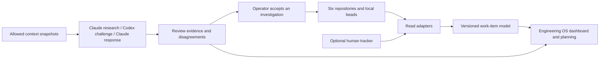

# Engineering OS integration review

Date: 2026-10-07. Scope: local source review and current public documentation.
Engineering OS revision inspected: `d7eceec`. Existing untracked workspace
prototype files were inspected but not edited or sent to model reviewers.

## Recommendation

Use engineering-os as the portfolio context and planning layer. Keep security
products separate deployable components, and keep the quorum a review service.
Linear is already optional in the documented design. The implemented dashboard
is coupled to the beads issue schema, not to a working Linear integration.
Do not replace that coupling with mandatory dependence on another cloud tool.

## What exists and what is missing

| Area | Evidence | Next step |
|---|---|---|
| Local context | Markdown vaults and hybrid SQLite retrieval | Evaluate retrieval on fixed multilingual questions and record coverage, freshness and citations |
| Task display | `dashboard/src/beads.ts` accepts bd or beads-shaped JSONL | Separate provider parsing from the internal work-item contract |
| Identity | `projectOf` derives project from an issue ID prefix | Add explicit repository/source identity; two databases may reuse a prefix |
| Freshness | `IssueStore` preserves a last-good snapshot and marks stale sources | Keep this behavior for each source independently in a multi-source view |
| Tracker links | Configurable external-reference URL already exists | Preserve provider and workspace metadata instead of assuming one URL template |
| Context boundary | Caller-selected vault/namespace filters in `rag/src/server.ts` | Treat these as retrieval filters, not permissions; keep private vaults outside cloud review packets |
| Review history | Coordinator stores snapshots, hashes, votes and stage events | Link runs to tasks and revisions; keep disagreements visible |
| Workspace discovery | Existing untracked `scripts/workspace.mjs` prototype | Reuse its inventory concept; adapt its output to the same run ledger without auto-applying proposals |
| Maintenance | README says Node 24; rag package requires Node >=26 | Align requirements and verify a clean bootstrap before claiming reproducibility |

The RAG server is plain HTTP. An MCP-capable client does not automatically make
that endpoint an MCP service. A narrow tool adapter would need explicit input,
output and access contracts. This is a proposed integration, not a deployed one.

## Current relevance

The local notes, task graph and review evidence combination remains a useful
architecture hypothesis. This review does not establish market demand or
competitive superiority. Validate usefulness with a concrete six-project flow:
resume work, identify a blocker, retrieve its decision, review a change, and
record the next task without requiring a cloud tracker account.

Public sources checked on the review date:

- [Linear GraphQL API](https://linear.app/developers/graphql): provider-specific
  team IDs, workflow states and GraphQL errors belong in an adapter. HTTP 200
  does not by itself establish complete success.
- [Linear webhooks](https://linear.app/developers/webhooks): use provider events
  for optional synchronization; design retries, deduplication and reconciliation
  before allowing writes.
- [GitHub Issues API](https://docs.github.com/en/rest/issues/issues): an alternate
  adapter must distinguish issues from pull requests and handle pagination.
- [Beads upstream](https://github.com/gastownhall/beads): keep the backend/version
  contract explicit. The installed local backend is embedded Dolt; do not assume
  the runtime database is a portable Git artifact. Export reviewed JSONL.
- [MCP architecture](https://modelcontextprotocol.io/specification/2026-07-28/architecture):
  MCP supplies a client/server interoperability boundary. It does not define a
  shared issue schema or resolve conflicting tracker states.

These sources support implementation choices, not a claim that every connector
has been implemented or tested.

## Portable contract proposal

Use `WorkItem/v1` with `source_id`, `repository_id`, `native_id`, title,
normalized status, raw provider status, priority, typed dependencies, provenance
and timestamps. Construct identity from source plus native ID; never infer it
solely from a display prefix. Preserve unmapped statuses as unknown, not done.

Each adapter declares read/write/dependency capabilities. Start with read-only
`list` and `get`, cursor pagination, explicit partial-result errors and freshness.
Implement beads and a versioned JSON fixture first, then prove that the same UI
can load a GitHub fixture. Linear is a later optional adapter, not the core model.
Do not invent dependency support where the provider cannot represent it.

Keep one authority per field and explicit links between execution tasks and
stakeholder tickets. Avoid bidirectional synchronization in the first iteration.
Later writes require idempotency keys, expected revision checks, a preview and an
explicit route to the correct repository/tracker. A review consensus is evidence
for investigation, not permission to merge or publish.

## Other dependencies to keep optional

Portability is wider than the ticket tracker. Keep Markdown as the knowledge
format and Obsidian as one editor. Preserve a search-provider interface so
planning can operate without an embedding model, using lexical or no retrieval
with an explicit limitation. Keep model-provider invocation behind the existing
review adapter; task identity and review history must not depend on Claude or
Codex session IDs. Separate local CLI use from future remote MCP authorization.

The dashboard should remain useful with only local JSON fixtures and beads.
Cloud account absence is a supported operating mode, not a setup error. Provider
capabilities and missing context should be visible to the user; do not silently
fall back to a cloud service or imply complete retrieval when a source is absent.

## Portfolio responsibilities

- engineering-os: context, source adapters, planning and the portfolio view.
- mcp-svid-auth: workload authorization; currently also hosts the review tooling.
- mcp-spiffe-bridge: workload transport integration where needed.
- hipaa-fhir-mcp: synthetic domain example behind the security boundary.
- ecs-contract: infrastructure/application ownership contracts.
- it-grc (IT GRC, not yet public): pushes executed lab evidence into CISO
  Assistant CE as the GRC system of record; approval stays a human decision.

Use a private registry with stable project IDs and local path bindings. Do not
merge all task databases or private vaults into one shared cloud prompt. Moving
the coordinator into a separate package can follow a stable interface; avoid
copying its implementation into engineering-os now.

## Implementation order and acceptance

Tracked in engineering-os beads epic `eos-nmy`: `eos-nmy.1` (contracts),
`eos-nmy.2` (review ledger), and `eos-nmy.3` (context and bootstrap).

1. Contract and identity: overlapping native IDs across two sources remain
   distinct; unmapped status and unsupported dependencies remain explicit.
2. Read adapters: beads, JSON and GitHub fixtures produce the same graph;
   partial failure preserves each source's last-good snapshot with a stale label.
3. Review ledger: an EOS card links a run, source revision, findings and votes;
   incomplete research cannot appear as a completed review.
4. Context policy and evaluation: private sources are excluded before model
   invocation; run repeatable retrieval questions and record misses as well as hits.
5. Optional tracker writes only after preview, conflict and idempotency tests.

## Quorum evidence

The focused engineering-os run is `20261007T120015388704Z`. Claude completed
its source review without web calls; the current-source research above was done
separately by the coordinating agent. The fixed allowlist includes four source files;
other modules, vault content and private configuration are outside model coverage.

Execution limitations: an earlier eight-file run timed out after 240 seconds.
The first verification response failed the vote contract and was discarded.
The focused run resumed after clarifying that verification and rebuttal return
votes only, never new findings. Its manifest hashes describe initialization;
the resumed prompt fix is recorded in the coordinator change, not those initial
hashes. Full historical replay across code changes needs versioned per-stage
implementation provenance in a later iteration.

Final outcome: all three real-provider stages completed. F1 is `unresolved`:
Codex voted `needs_test`; Claude's response voted `support` while withdrawing
parts of the original claim. Adapter coupling is supported by the inspected
source; a present multi-repository collision or tracker incompatibility is not
established. No finding was automatically promoted to a defect or implementation.
The existing `eos-nmy` tasks are operator-authored design investigations.

See the [interactive quorum record](quorum-engineering-os/index.html),
[full reviews](quorum-engineering-os/report.json), and
[event journal](quorum-engineering-os/events.jsonl).

Validation of coordinator changes: 493 tests passed, lint/types/generated docs
passed, and the documentation build passed. Engineering OS application behavior
was not changed or retested by this research task.

### Kimi peer attempt

On 2026-10-07, two authenticated Moonshot requests were made for an additional
peer vote using `kimi-k2.6`. Neither response passed the strict review contract.
The second response failed JSON parsing; its reported usage was 8,114 input and
6,057 output tokens (14,171 total). The first response's usage was not retained,
so this is not a total-cost or total-token claim for both attempts.

No Kimi vote was accepted and the original unresolved finding is unchanged.
Further paid retries were stopped. A follow-up adapter change now preserves
safe validation categories and usage for schema failures without retaining raw
response content. See the [failure record](quorum-engineering-os/kimi-failure.json).
Follow-up remains open as `svid-3ve`.

### Accepted Kimi peer and portfolio rollout

A subsequent explicitly initiated pass with thinking disabled produced a valid
review with exact-line evidence. Kimi voted `needs_test` on F1, so the finding
remains unresolved. The accepted request used 8,114 input and 742 output tokens
(8,856 total). A separate synthetic JSON connectivity check used 62 tokens.
These counts do not include the earlier failed requests.

See the [accepted peer record](quorum-engineering-os/kimi.json). New live run
manifests now require Kimi across all six projects. The prepared portfolio run
`20261007T122242280168Z` contains mcp-svid-auth, hipaa-fhir-mcp,
mcp-spiffe-bridge, ecs-contract, ciso-assistance (since renamed IT GRC) and
engineering-os. It is a
prepared source snapshot, not evidence that the full new portfolio was reviewed.
Each project proceeds through the three original stages and then Kimi. Failures
in one project do not suppress reviews of independent projects. A missing Kimi
vote prevents completion and promotion of proposals for new runs.
