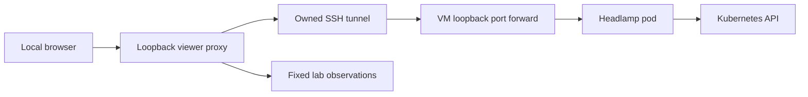

# Headlamp security lab interface

The local interface uses CNCF Headlamp 0.45.0 with an original lab plugin. It
connects the three security projects running on Lima, Kubernetes and containerd.
`ecs-contract` is excluded. This is a proof of concept for a local operator.

## Open and stop

```sh
make ui
```

Open [Security lab](http://127.0.0.1:4466/c/main/security-lab). The command starts
the dedicated VM and lab if absent, starts the local viewer in a detached
process, waits for its authenticated readiness check and returns. Keeping a
terminal or this chat open is not required. Running it again returns the same
verified session. It does not run the demo assertions; use `make demo` for a
fresh report.

```sh
make ui-stop      # stop the local viewer and its tunnel
make down         # remove the owned lab namespaces and ephemeral keys
make runtime-stop # only when no sibling project needs the shared VM
```

Closing the browser tab does not stop the VM. The viewer has no login-time or
boot-time autostart. The VM is capped at two CPUs and 4 GiB of guest memory.

## Optional human sign-in

```sh
make ui-login      # provision the optional local identity profile and viewer
make identity-demo # verify WebAuthn and the allowed/denied OIDC exchanges
make ui-login-down # stop the viewer and remove only the identity profile
```

The requested ZITADEL profile is an explicit exception to the CNCF-only tool
selection. It runs ZITADEL 4.19.4, its matching Login V2 frontend and a
digest-pinned PostgreSQL image in `security-lab-identity`, inside the existing
VM. There is no second VM. The normal `make ui` remains available; while the
identity profile exists it requires human sign-in and cannot fall back to an
unauthenticated viewer.

Use [the canonical identity-enabled panel](http://localhost:4466/c/main/security-lab)
and choose **Continue with ZITADEL**. Keep `localhost` throughout sign-in: the
callback and WebAuthn relying-party name must match it. The original password
demo has been replaced in code by the requested passwordless profile. Its previous
successful password login is historical evidence, not acceptance of the new
profile.

The two local test accounts are `viewer@example.org` and
`unprivileged@example.org`. Only the first has the viewer role and an explicitly
approved stable subject. Account identifiers stay in ignored
`deploy/.data/human-demo-accounts.json`, with mode 0600. Test accounts are created
without passwords. The acceptance helper uses an ephemeral authenticator to
prove an actual signed WebAuthn exchange; it is not a real user's passkey.

The intended operator profile uses an administrator-linked Google identity
followed by WebAuthn with required user verification, such as a device PIN or
biometric check. Registration, automatic user creation and automatic linking
by email are disabled. Password, SMS and OTP recovery are not fallback paths.
The selected organization policy must allow only
`U2F_WITH_VERIFICATION` in `multiFactors`, with `secondFactors` empty. Signed
`amr` alone does not distinguish a verified authenticator from ordinary U2F;
read back the effective provider policy and require user verification on the
WebAuthn challenge as separate acceptance checks.

Google sign-in is not connected yet. It requires the operator's intended
account, a Google OAuth client and its exact redirect URI, private credentials,
an explicit identity link and verified restricted network access. No email
address match alone grants access. The local synthetic passkey profile is the
first independently testable increment. **Sign out** ends the local panel
session; the next sign-in explicitly requests login again.

The gate uses Authorization Code with S256 PKCE, a one-use state, a nonce and
the fixed callback `http://localhost:4466/_auth/callback`. It validates the
RS256 signature, issuer, client and a bounded ID-token lifetime. ZITADEL adds
the owning project to its ID-token audience: the gate accepts only the exact
client/project pair with `azp` bound to that client, or the single client.
No other audience is accepted. The signed viewer role must belong to the
configured organization. The subject must also be on the approved list,
`amr` must contain exactly `user` and `mfa`, and signed `auth_time` must be no
older than five minutes. A valid account without these checks is denied.

After verification, OIDC tokens are discarded. The panel browser receives an
opaque HttpOnly, SameSite=Lax cookie; its server-side session expires within
five minutes. Provider login cookies remain separate and are never forwarded
to Headlamp. Kubernetes reads still use the gate's own ten-minute read-only
ServiceAccount credential. Human identity grants no MCP tool, record or FHIR
permissions. Workload JWT-SVID and single-resource `at+jwt` checks are unchanged.

The provider entry point is fixed to loopback port 4467. Only public OIDC
endpoints and Login V2 are exposed; management APIs and the administration
console are unavailable. The local operator provisions the demo through private
loopback forwards. No identity service has a public Service, host port,
ServiceAccount token or external network egress. Only same-namespace traffic
and DNS are permitted. Every workload is non-root with a read-only root and
dropped capabilities. Memory limits are 640 MiB for ZITADEL and 384 MiB each
for its login frontend and database.

This is a loopback HTTP demo. The proxy retains the provider's Secure cookie
attribute; the canonical `localhost` origin is required for the local login
client. Do not expose these endpoints remotely or treat this profile as a
production HTTPS deployment. A signed top-level return navigation from
port 4467 is permitted only to the canonical panel document; same-site API
requests and iframe navigations remain denied.

Database data and signing keys are ephemeral. Bootstrap and login-client PATs
are generated at runtime and expire after two days. Recreate an expired or
incomplete profile with `make ui-login-down` followed by `make ui-login`.
`make ui-stop` closes all owned UI/identity forwards but keeps the profile.
`make down` removes all three owned namespaces and the local account files;
`make runtime-stop` releases the VM memory; skip it while another sibling
project uses the VM. IT GRC runs in its own Lima VM and does not depend on this
one. Identity backend loss stops the viewer rather than bypassing login.

The identity acceptance gate must verify real WebAuthn for both synthetic
accounts, required user verification, password denial, PKCE exchange, an opaque
session, viewer observation, Secret and mutation denial, callback replay denial
and local logout. It saves verdict labels and a timestamp only in ignored
`deploy/.data/identity-demo-report.json`. Browser checks must separately verify
the final login flow and the panel's role badge. The main replacement passed
eleven real WebAuthn/OIDC checks on 2026-10-06. Its five protected desktop views,
role badge and browser logout were verified. The hosted Login V2 form reached
passkey authentication without showing a password form. Full physical-device
completion and Google integration remain separate operator gates. The final
recovery cycle also passed the 390 x 844 mobile layout and full scoped lifecycle;
see the README Status table.
See [passwordless setup, proof and recovery](passwordless-identity.md).

For foreground debugging, use `uv run --locked python -m scripts.kubernetes_ui
serve`; Ctrl-C then closes the viewer and its tunnel. After a host viewer crash,
`make ui` recovers the stale session only if both fixed loopback ports are free.
It refuses an occupied port or an unverifiable session, and never terminates a
process identified from a saved PID. The next start resets only the fixed
forwarding unit in the verified dedicated VM. The guest forwarder has an
eight-hour maximum lifetime. If it or the SSH tunnel becomes unavailable, the
viewer closes and removes its session record; `make ui` starts a new session.

## Five views and their evidence

| View | What it shows | Source and limit |
|---|---|---|
| Services | Readiness and restarts of nine base services, plus three optional identity services; guest memory | Current Kubernetes controllers and pods in fixed owned namespaces; memory excludes macOS overhead |
| Trust map | SPIRE identities and the credential exchange path | Configured identities, not an inventory of currently issued certificates |
| Permissions | Caller, resource and allowed scopes | The actual local policy file used by the lab |
| Audit | A bounded selection of safe outcomes | Recent logs from four fixed services; no raw payloads, tokens or keys |
| Demo | Verdicts for the eighteen security scenarios | The last saved demo report and its timestamp; not continuous validation |

The plugin refreshes every fifteen seconds; the local observer caches successful
snapshots for ten seconds. A failed refresh displays an explicit stale-data
notice. The audit view is not durable storage or an audit-chain verifier.

## Connection and access



The browser receives no Kubernetes credential. The local proxy requests a
ten-minute ServiceAccount token, retains it only in process memory and refreshes
it before expiry. If refresh fails, requests fail with a fixed error. Incoming
authorization, cookies and forwarded identity headers are discarded. The proxy
injects its own viewer identity and credential for Headlamp's supported
identity-aware proxy mode.

The viewer binds to `127.0.0.1` and checks Host, Origin and Fetch Metadata before
handling requests. Lima's automatic port forwarding is explicitly disabled for
all guest addresses. Headlamp listens only on the pod's loopback address and has
no Service, Ingress or NodePort. The dedicated SSH tunnel and guest forwarding
unit close when the viewer exits.

The Headlamp ServiceAccount has read-only Roles in `security-lab` and
`spire-system`. It can read workload status, services, events and logs. It cannot
read Secrets, create or edit resources, execute commands, open forwarding
sessions, or inspect other namespaces. The local proxy also denies mutation
requests and sensitive endpoints. The only Kubernetes POST operations it
forwards are the three standard self-subject permission review endpoints.
Cluster-wide Headlamp pages can therefore show permission errors; the lab plugin
uses only the fixed namespaces.

The Headlamp pod runs as a non-root user, drops capabilities and uses a read-only
root filesystem. Its writable scratch volume is bounded to 256 MiB on disk.
Its resource limits are 500 millicores and 256 MiB. A projected API token expires
after ten minutes; automatic ServiceAccount token mounting is disabled. No
SPIFFE socket or application signing key is mounted into the UI pod.

Starting the lab and collecting fixed observations are local administrative
operations through the VM's existing kubeconfig. They do not grant equivalent
access to the browser: the observation endpoint projects allowlisted fields and
the Headlamp backend uses the separate viewer credential. The local operator can
still access the VM directly. This interface is not a public multi-user service
or a production authorization boundary against the machine's owner.

## Validation

The offline tests cover request denial, header replacement, credential refresh
failure, snapshot projection, namespace-only RBAC and Lima forwarding rules.
`make demo` checks the real security flows and waits for Headlamp readiness.
The README Status table records the current integration and browser results.

On 2026-10-05 the five plugin views rendered in the in-app browser. All nine
services were ready and observed guest memory was approximately 1.4 GiB. The
live viewer read pods in both lab namespaces; reads in `kube-system`, Secret
reads, command execution, resource creation and foreign Host/Origin requests
were denied. Browser responses contained no JWTs or credential cookies. On
connection loss, the plugin explicitly marked the retained snapshot as stale.
Viewer shutdown, lab teardown and VM shutdown passed before a fresh demo run.

The 2026-10-06 recovery checks cover a detached launch, an idempotent second
start, restart after an interrupted viewer, stale-state recovery, shutdown and
refusal to replace an unverified listener. Local session probes require the
private shutdown capability and never mint or return a Kubernetes credential.
The added offline tests also cover malformed lifecycle headers and backend
availability probes without credentials. The main profile subsequently passed
idempotent start, identity-backend-loss shutdown, recovery and a scoped cleanup
that retained CISO's namespace identity and the shared VM. A later repeat was
interrupted by host disk exhaustion and guest I/O errors. After the
operator-approved VM restart, the full fresh cycle passed by 15:31 UTC,
including mobile layout, browser logout, backend-loss shutdown and recovery.
Final scoped cleanup removed the three owned namespaces, private identity
records and all five listeners while preserving CISO's namespace UID and the VM.

On 2026-10-06, sixty-four samples at five-second intervals across the final
recovery cycle including native startup observed a maximum of 1858.1 MiB in
the shared guest, calculated as `MemTotal - MemAvailable`, with no measurement
errors. This is a sampled maximum for that window, not an instantaneous peak
or a Docker performance comparison. The 4 GiB cap excludes macOS
overhead, retained Docker data, host package caches and the optional local
model. Check host free space before image builds; a guest memory limit alone
cannot prevent host disk exhaustion. That failure interrupted an earlier cycle
despite the guest memory cap. The recovered mobile header wraps its viewer
controls; the Refresh button was visible at 390 x 844 and the document had no
horizontal overflow. All five protected desktop views and the mobile capture
were visually inspected.

Headlamp's built-in cluster-wide discovery can log expected permission errors
under these namespace-only Roles. The plugin views do not need that discovery.
The plugin package declares the 0.14.0 plugin API used by Headlamp 0.45.0; this is
compatibility metadata and does not require a local npm installation.

`deploy/headlamp` intentionally has no npm lockfile. The plugin ships as plain
JavaScript: `scripts/kubernetes_ui.py` loads only `main.js` and `package.json`
into a ConfigMap, and nothing runs `npm install` for it, locally or in an image.
A lockfile would pin about 1,300 development packages that never run.

### Security invariant review

| Invariant | Effect and evidence |
|---|---|
| Deny by default | UI HTTP tests reject foreign origins, sensitive paths and mutations; OIDC tests and the real identity check deny anonymous and unprivileged viewers |
| Audience binding | OIDC tests reject wrong client, project and authorized party; MCP single-resource checks and the real cross-resource scenario are unchanged |
| No token passthrough | Header replacement and provider-cookie tests prove incoming credentials are discarded; the panel receives an opaque session only, never OIDC tokens |
| Strict token checks | OIDC tests reject forged signatures, wrong algorithms, missing claims, unapproved subjects, password/OTP evidence, stale authentication and nonce/state failures; MCP token formats remain unchanged |
| No secrets in output | Tests verify fixed failures, safe snapshots and cookie/header isolation; identity reports contain labels and timestamps only |
| Fail closed | Expiry/logout and refresh-failure tests revoke local access; owned tunnel/backend loss closes the viewer; stdio behavior is unchanged |
| Runtime keys | Manifest tests prove private volumes, digest pins and no public ports; PATs and provider keys are runtime-only; test accounts have no passwords; privacy and secret scans remain commit gates |

`test_google_identity_config.py` proves the onboarding inputs cannot enable
registration, leak secrets or replace verified identity evidence.
`test_provider_readback.py` rejects inherited or foreign organization policies,
weakened factors and additional active providers. `test_google_setup_lifecycle.py`
proves setup cannot replace an unverifiable viewer connection or dismantle the
active panel's identity tunnel. `test_mtls_probe.py` preserves
trust and hostname verification and refuses to count outages or HTTP responses
as TLS rejection; its host audit case checks the container helper stays out of
local audit startup. These additions change validation and optional human
identity setup, while the eighteen live workload scenarios preserve the
single-resource token and per-tool boundaries.

Primary references: [CNCF Headlamp](https://presentations.cncf.io/projects/headlamp/),
[Headlamp 0.45.0](https://github.com/kubernetes-sigs/headlamp/releases/tag/v0.45.0),
[identity-aware proxy](https://headlamp.dev/docs/latest/installation/in-cluster/identity-aware-proxy/)
and [plugin format](https://headlamp.dev/docs/latest/development/plugins/building/).

Identity references: [ZITADEL Kubernetes deployment](https://zitadel.com/docs/self-hosting/deploy/kubernetes),
[Login V2 client](https://zitadel.com/docs/self-hosting/manage/login-client),
[ZITADEL 4.19.4](https://github.com/zitadel/zitadel/releases/tag/v4.19.4)
and [OIDC ID-token validation](https://openid.net/specs/openid-connect-core-1_0.html#IDTokenValidation).
See also [Google identity-provider setup](https://zitadel.com/docs/guides/integrate/identity-providers/google)
and [ZITADEL Authorization Code with PKCE](https://zitadel.com/docs/guides/integrate/login/oidc/login-users).

## Namespace-scoped resource browsing

The plugin initializes Headlamp's `main` cluster settings with the explicit
`security-lab` and `spire-system` namespace list before registering its routes.
A fresh browser otherwise attempts cluster-wide resource lists, which the
read-only ServiceAccount correctly rejects. Existing appearance settings are
preserved, invalid default namespaces are replaced, and selector-based namespace
expansion is removed. If browser storage cannot save the bounded settings, plugin
initialization fails with a fixed error rather than claiming successful setup.

This is a frontend request-routing preference, not an authorization grant.
Kubernetes RoleBindings remain namespace-scoped; cluster-wide lists, Nodes,
Secrets and mutations remain unavailable. Headlamp's built-in cluster-only views
can still show permission denials. Use the Security lab view or namespaced Pods,
Services and Deployments for the supported demo.

The pinned [Headlamp cluster-settings contract](https://github.com/kubernetes-sigs/headlamp/blob/v0.45.0/frontend/src/helpers/clusterSettings.ts)
and [namespaced list requests](https://github.com/kubernetes-sigs/headlamp/blob/v0.45.0/frontend/src/lib/k8s/KubeObject.ts)
define this behavior. Client settings can be edited, so they must never replace
server-side RBAC or the existing OIDC approval gate.

### Local acceptance on 2026-10-20

The fix was checked from the `84a38c4` base plus the local plugin/test changes in
a separate disposable VM, not the operator's stopped lab. A fresh browser opened
Pods (10 rows during the scenario run), Deployments (8) and Services (7) without
the previous permission error. These are observations from that test run, not
fixed resource counts. Direct reads of the supported namespaced resources
returned 200. Cluster-wide Pods, Nodes, Secrets and an unrelated namespace
returned 403; a pod mutation returned 405. No RBAC grants were widened.

`make check` passed 560 Python tests on Python 3.13.9, 8 new JavaScript
regressions, Ruff and strict mypy. The strict documentation build, actionlint and
redacted secret scan passed. `make demo` passed all 18 scenarios; the retained
private report has SHA-256
`c33f4d7159c0aa7c641cd2a497f8e2f6e0fe04e27c5502915b9cdf4df542331a`.
`make down` removed only this validation VM's test namespaces, and the validation
VM was stopped. The original lab VMs and operator profile were unchanged.

This browser acceptance uses the supported standalone read-only viewer in an
identity-free test VM. It does not claim a new physical-passkey ceremony or a
combined manual OIDC acceptance after the fix. The owner must repeat that step.

| Security invariant | Effect of this change | Check |
|---|---|---|
| Deny by default | Server policy and RBAC unchanged; browser defaults are not authority | Existing RBAC tests and live 403/405 checks |
| Audience binding | No token code changed | Existing token checks and demo scenario 4 |
| No token passthrough | No forwarding code changed | Existing tests and demo scenario 8 |
| Strict token checks | No token format or validation changed | Existing token tests and full demo |
| No secrets in output | Storage failure uses one fixed error | New unavailable-storage regression |
| Fail closed | Refresh and child shutdown unchanged | Existing expiry tests and full demo |
| Runtime keys | No keys added to source or browser settings | Identifier tests and secret scan |
