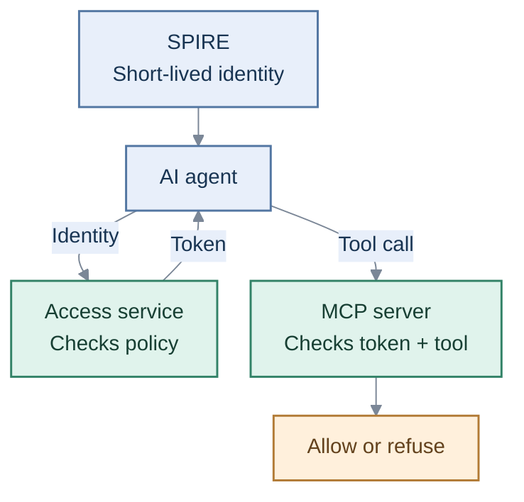

Workload identity / OAuth

# Give agents access that expires.

An agent proves its identity, gets permission for one server and calls only the tools it is allowed to use. No static API key.

## How it works

[Run the demo](quickstart.md){ .overview-link }
[Technical architecture](architecture.md){ .overview-link }
[Security limits](security.md){ .overview-link }

## Where ZITADEL fits

**People: ZITADEL → sign-in gate → read-only Headlamp.**
**Agents: SPIRE → access service → MCP tools.**

[Human sign-in and passkey boundaries](passwordless-identity.md).
Human-to-agent delegation is not implemented; real Google sign-in and physical passkey enrollment remain operator gates.

!!! note "Scope"
    Prototype. Identity proves the workload, not the human intent.
