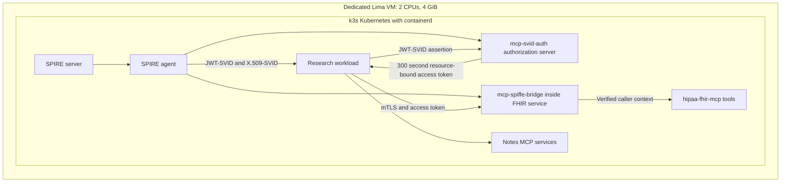

# Shared Kubernetes security lab

This local proof of concept connects `mcp-svid-auth`, `mcp-spiffe-bridge` and
`hipaa-fhir-mcp`. `ecs-contract` is excluded. It does not deploy a cloud cluster.
The [Headlamp interface](headlamp-ui.md) provides a local read-only view.

!!! note "Requires components that are not yet published"
    `mcp-spiffe-bridge` is not yet published, so this lab cannot be reproduced
    from public sources. The [quickstart](quickstart.md) single-repository path
    (tests, local end-to-end demo, packaging and interoperability) needs no lab.
    Results on this page are recorded evidence from the maintainer's environment.

## Components and requests



The bridge is a library loaded by the FHIR gateway, not an extra independently
running daemon. The gateway uses the existing FHIR tools with an explicitly
synthetic, offline FHIR adapter. It does not call the public sandbox or real data.
Its domain schemas, fixture, gateway and audit checker stay in the FHIR repository.
The shared lab receives bounded pass/fail outcomes from that checker.

The FHIR endpoint is `https://fhir.security-lab.svc.cluster.local:8443/mcp`. Its
X.509-SVID includes this DNS name, so clients keep normal CA and hostname checks.
The access token must have exactly this audience, `fhir:read`, the fixed issuer,
and a subject equal to the authenticated mTLS peer. Public verification keys are
fetched from the fixed local issuer without forwarding incoming credentials.
There is no write scope for the FHIR service.

SPIRE node attestation uses a projected ServiceAccount token with audience
`spire-server`. Workload registration requires both Kubernetes namespace and
ServiceAccount selectors. Copying a research label onto an intruder workload does
not change its identity. The kubelet's certificate is verified. Neither the
containerd socket nor a Podman socket is mounted into SPIRE or application pods.

## Start, inspect and stop

Check out the three security repositories as siblings; `mcp-spiffe-bridge` is
not yet published, so this step requires maintainer access. Install Lima 2.2.1+ and
the root project's locked Python dependencies. The VM mounts only those three
repositories, read-only, and does not share home directories or SSH credentials.

```sh
uv sync --locked
make lab-render   # review generated manifests without starting a VM
make up           # start the VM, build local images and launch the services
limactl shell security-lab sudo k3s kubectl -n security-lab get pods
make down         # remove this lab's namespaces, RBAC and workload socket
make runtime-stop # only when no sibling project needs the shared VM
```

For a fresh full validation, use `make demo` instead of `make up`. It starts the
same stack and asserts all 18 scenarios, including the original OAuth cases,
real SVID renewal, copied-label denial, three FHIR tools, wrong-audience denial,
absent/disallowed client certificates, input rejection and the FHIR audit check.
Existing namespaces cause a refusal; run `make down` before a fresh run.

The review preview contains explicit runtime placeholders for image digests and
the trust bundle. Startup supplies real values; do not apply the preview manually.

The VM uses k3s **v1.37.1+k3s1**, which embeds Kubernetes **1.37.1** and
containerd **2.3.4-k3s1**. Release binaries and Debian base images are pinned by
checksums. SPIRE and application base images are pinned by digest. Locally built
images are imported into containerd and referred to by their resulting digest;
`imagePullPolicy: Never` prevents a registry fallback. Buildah and Skopeo belong
to CNCF Podman Container Tools and are used only for local image construction and
inspection. No container engine API is used for builds, and no image is pushed.

The profile limits guest memory to 4 GiB and disables Traefik, ServiceLB,
metrics-server and local-storage. Every application has CPU/memory limits,
a read-only root filesystem, no Linux capabilities and no mounted Kubernetes
API token. The separate Headlamp viewer uses a short-lived projected API token
and read-only namespace Roles. Runtime keys live in ephemeral volumes or process
memory. Automatic host port forwarding is disabled; the admin kubeconfig stays inside the VM with
mode 0600. The driver always targets the VM's loopback API endpoint.

Stopping releases compute resources. It retains VM disk and image caches.
Building images requires additional disk space and temporarily more CPU than
an idle lab. The 12 GiB sparse guest disk does not limit total host cache usage.

## Validation on 2026-10-06

A fresh rebuild with private umask 077 passed all eighteen scenarios at 14:55
UTC. A repeat with the native ZITADEL profile enabled passed eighteen at 15:02
UTC, using fresh notes-a credential and FHIR audit state. The no-certificate
probe requires an explicit peer TLS alert rather than a generic transport reset.
Public image staging files are readable by the non-root container user without
changing private source files or runtime credential permissions.

The main profile passed eleven synthetic WebAuthn/OIDC checks and four closed
Google provider setup checks with fake inputs. Five protected desktop views,
actual browser logout, detached/idempotent start, shutdown on identity backend
loss and recovery passed. The hosted login form reached passkey authentication
without a password form. These checks do not prove a physical authenticator or
real Google login. See [identity evidence](passwordless-identity.md).

An earlier final cycle failed after macOS disk exhaustion and guest I/O errors.
After the operator-approved VM restart, the complete recovery cycle from 15:25
to 15:31 UTC passed: a fresh eighteen-scenario rebuild, native startup, viewer
stop/restart/idempotence, backend-loss shutdown and recovery, eleven identity
checks, four closed Google setup checks and five desktop views plus mobile.
The final `make down` removed the three owned namespaces, private identity
records and all five viewer listeners while preserving CISO's namespace UID
and the running shared VM. Sixty-four five-second samples including native
startup observed at most 1858.1 MiB guest use, with no measurement errors.
Do not stop the shared VM while a sibling project depends on it without
coordination.

## Earlier validation on 2026-10-05

The final fresh image build and `make demo` run passed all 18 scenarios. Its
report started at 13:58:44 UTC. `make down` removed the owned namespaces, RBAC
and workload socket, then `make runtime-stop` stopped `security-lab`.

| Check | Result |
|---|---|
| Root `make check` | 242 tests; lint, formatting, strict types and generated configuration passed |
| Gateway token verifier | 21 Node crypto and configuration assertions, exercised by the root test suite |
| Bridge | 56 tests including real TLS handshakes, expired credentials, stream loss and failed startup; types and build passed |
| Bridge lint | Passed with nine existing warnings |
| FHIR | 10 tests including independent MCP client calls, concurrent caller isolation and stderr audit; types, formatting and build passed |
| FHIR log scan | Zero sensitive-data findings |
| Integration | All 18 scenarios passed with real SPIRE and Kubernetes ServiceAccount attestation |
| Privacy and secret scans | Root tree and full-history privacy checks passed; all three Git histories and non-ignored source snapshots had zero Gitleaks findings |

The security review covered all seven root invariants:

| Invariant | Evidence |
|---|---|
| Deny by default | Gateway startup refuses undeclared or duplicate tool scopes; crypto/configuration tests and live unknown-tool rejection passed |
| Audience binding | Signed tokens require one exact resource URI; crypto tests and cross-resource live replay denial passed |
| No token passthrough | Existing byte-capture regression checks and the new public-key fetch capture test passed |
| Strict token checks | ES256, `at+jwt`, issuer, audience, caller and lifetime checks passed; live expired assertion and strict replay denials passed |
| No secrets in output | Fixed error strings, bounded outcomes, FHIR audit assertions, privacy checks and secret scans passed |
| Fail closed | Existing stdio expiry/cleanup tests and bridge expiry/stream-loss tests passed; the gateway exits after identity loss |
| Runtime keys | SPIRE state uses ephemeral memory volumes, gateway audit keys are generated in memory and TLS test keys are generated at runtime; source and history scans passed |

At 13:56:17 UTC after the preceding successful run, guest used memory was
**1311.3 MiB**, calculated as `MemTotal - MemAvailable`. Container working sets
totalled **618.0 MiB**, including CoreDNS; the FHIR gateway accounted for
109.5 MiB. This single idle snapshot excludes macOS/Lima overhead and image
build peaks. It is not a Docker comparison or a performance guarantee. The
configured VM cap remains 4 GiB. Safe local results remain under ignored
`deploy/.data/`; no image, commit, package or runtime was published externally.

## Trust boundary and remaining work

This is a single-node lab, without production availability, a managed secrets
store, durable audit retention or a production FHIR backend. The OAuth issuer
uses explicitly local HTTP; the FHIR transport uses real mTLS. SMART-on-FHIR and
KMS implementations remain out of scope.

Anyone who controls the cluster or may create workloads with an authorized
ServiceAccount can assume that identity. The SPIRE agent runs as root with host
PID visibility, and application pods mount the node's Workload API socket.
Namespace/ServiceAccount attestation strengthens the previous label-only demo,
but it does not protect against the VM or cluster operator.

The gateway rejects calls if its credential stream is lost or expired. It exits
after stream loss so Kubernetes replaces the process and obtains fresh identity.
Bridge instances cannot restart after stop or failed startup; create a new one.

Next steps are a SPIFFE CSI socket mount, explicit admission/RBAC restrictions
on who may use each ServiceAccount, persistent independently retained audit
checkpoints, and HTTPS for the issuer with verified workload credentials.

Primary references: [k3s CNCF project](https://www.cncf.io/projects/k3s/),
[k3s release and embedded versions](https://github.com/k3s-io/k3s/releases/tag/v1.37.1+k3s1),
[SPIRE PSAT attestation](https://github.com/spiffe/spire/blob/v1.15.3/doc/plugin_server_nodeattestor_k8s_psat.md),
[SPIRE Kubernetes workload attestation](https://github.com/spiffe/spire/blob/v1.15.3/doc/plugin_agent_workloadattestor_k8s.md).
