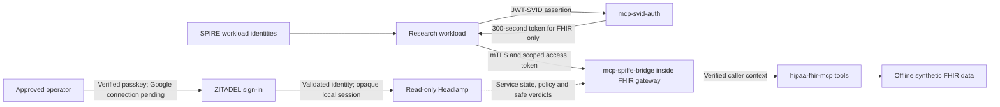

# Development plan for the security portfolio

Updated on 2026-10-06 against the local checkouts. The shared Kubernetes lab connects three projects and passed eighteen scenarios both after a fresh rebuild and with the main passwordless profile enabled. Native human sign-in passed eleven real synthetic WebAuthn/OIDC checks, responsive interface checks and the complete scoped lifecycle after operator-approved VM recovery. Real Google integration remains a separate operator gate. This plan distinguishes recorded proof and subsequent delegation work. Earlier standards and market research below was checked on 2026-10-04; it is dated evidence, not a continuously refreshed trend report.

Keep `mcp-svid-auth` as the lab coordinator, `mcp-spiffe-bridge` as a TypeScript transport library, and `hipaa-fhir-mcp` as its synthetic domain consumer. Keep the repositories independently buildable. `ecs-contract` remains a separate AWS configuration ownership tool and is excluded from the Kubernetes lab. The common theme is making identity, authority, data boundaries and configuration ownership explicit and testable.

## Project roles and priorities

| Project | Implemented role | Next useful outcome |
|---|---|---|
| `mcp-svid-auth` | JWT-SVID exchange, resource-bound access tokens, per-tool policy, shared Lima/Kubernetes/containerd lab and passwordless read-only Headlamp UI | Complete real Google and physical passkey operator gates, then independently bounded delegation |
| `mcp-spiffe-bridge` | Real SPIRE mTLS in the FHIR gateway, verified caller context and fail-closed credential lifecycle | Preserve the small library boundary; test reconnect and trust-root rotation before broadening its deployment scope |
| `hipaa-fhir-mcp` | Three tools using offline synthetic data, workload-bound OAuth, request-local caller context and safe stderr audit | Runtime-validate and minimize real HTTP FHIR responses, complete stdio rejection audit and authorize access to selected records |
| `ecs-contract` | Offline declarations, render/guard/drift and configuration ownership | A separate compact ownership demo with stale-plan and rollback checks |

## How the implemented lab fits together

The bridge verifies the TLS peer. The FHIR gateway separately verifies the access token, whose subject must match that peer's SPIFFE ID. The tools receive the trusted request context. Kubernetes coordinates process startup and discovery; it does not decide clinical access. The base has nine service pods; the optional identity profile adds three. The bridge is a library inside the FHIR gateway.

The local operator can use the base viewer or enable the human sign-in profile with `make ui-login`. There is no implemented user delegation or authorization of individual clinical records. The current gateway uses an offline fixture; the standalone HTTP FHIR client is a separate boundary with remaining validation work.

## Optional evidence-oriented demonstration

The separate IT GRC project (`it-grc`, not yet public; formerly
`ciso-assistance`) pushes executed lab evidence into the unmodified CISO
Assistant Community edition (CE), used as the GRC system of record. CE runs on
k3s in its own Lima VM, `it-grc`, not in the shared security-lab VM. Its input
is the credential-free demo report that `make demo` writes, or a retained copy.
The bridge maps the eighteen scenarios to the public NIST SP 800-66 rev2
framework, sets at most `partially_compliant` with status `in_review`, and
leaves `compliant`, `done` and evidence approval to a human reviewer in CE.

This is a downstream consumer of the lab's saved evidence, not a new
authentication authority. It has no lab Kubernetes API credential, no automatic
remediation and no FHIR access. Its CE sign-in is separate from the Headlamp
sign-in gate; shared single sign-on would need its own approved client, callback
and application role. A saved report is dated evidence, not a live check of the
lab. Any later live access to the lab must use a separately attested SPIRE
workload and its own narrowly scoped token. The Headlamp session and a Google ID
token must never serve as that credential. The two VMs have separate lifecycles.

## Human identity demo: optional OIDC provider

The selected ZITADEL profile is the requested exception to the CNCF-only selection. It uses a real OIDC gate and runs ZITADEL, Login V2 and PostgreSQL on demand inside the existing Lima VM. The tools remain separate from workload identity. See [operation and boundaries](headlamp-ui.md#optional-human-sign-in).

The first increment is passwordless human sign-in for the local read-only panel:

1. A synthetic operator proves possession of a passkey with required user verification, then completes Authorization Code with PKCE. Real Google identity linking remains pending operator configuration.
2. A server-side session gate verifies the issuer, client, callback, state, nonce and token lifetime, and checks a local viewer role, an approved stable subject and fresh signed authentication evidence.
3. The gate discards OIDC tokens after validation. The browser gets an opaque five-minute session cookie. The existing namespace-scoped viewer credential still serves Kubernetes reads.
4. An authenticated user without the viewer role is denied. A successful human login grants no additional MCP tool or data permissions.

Keep the existing machine-to-machine exchange unchanged in that increment. Do not replace the accepted JWT-SVID assertion with a generic OIDC JWT or assume that a provider's private-key JWT profile accepts SPIRE credentials. Do not forward a user's OIDC token to the MCP server, Kubernetes API or FHIR backend.

Human-directed tool access is a subsequent, separately specified token contract. A verified user grant and the acting workload's SPIRE identity must both be checked before a new, short-lived, single-resource credential is issued. Permissions must be the intersection of the user's permitted operations, the workload policy and the requested record context. Current tokens identify the workload and require `sub` to match mTLS; adding a human subject must not silently weaken that check. SMART authorization for a clinical FHIR backend remains a separate integration.

## Acceptance gates for the additional profile

| Gate | Required evidence |
|---|---|
| Real login | Actual signed WebAuthn with user verification and OIDC callback; permitted viewer and authenticated-but-unprivileged viewer; password, SMS, OTP and unapproved subjects denied |
| Provider policy | Effective organization policy read back, second factors empty and only U2F with user verification allowed; Google auto-creation and email auto-linking disabled before accepting Google integration |
| Session boundary | Wrong issuer/audience, invalid state/nonce, expired session and CSRF attempts denied; logout closes the local session |
| Credential isolation | No OIDC or Kubernetes bearer token in page storage, safe verdicts or logs; namespace RBAC and no token passthrough preserved |
| Local scope | Canonical localhost entry point, dedicated owned resources, synthetic accounts without passwords, runtime-generated keys and digest-pinned images |
| Resource budget | Measure total guest memory and startup peaks including database/login components; stay within the existing 2 CPU / 4 GiB cap before accepting the profile |
| Baseline compatibility | Existing eighteen scenarios still pass with the profile disabled and enabled; UI continues to report the real verdicts |
| Lifecycle | Complete startup, stop and restart without affecting sibling projects or unrelated containers; no boot autostart |

The OIDC gate and optional provider resources passed the local synthetic passwordless acceptance and full lifecycle. Real Google linking and physical passkey enrollment remain operator gates. User delegation and individual record authorization remain subsequent work. Human roles in this synthetic demo are not evidence of HIPAA compliance or clinical consent.

This prioritization is a judgment about the inspected implementation and maintenance cost. No user interviews, adoption figures, revenue estimates, or market size were measured.

## Public developments checked on 2026-10-04

| Verified public evidence | Implication for these projects |
|---|---|
| MCP's current authorization page resolves to revision 2026-07-28 and requires resource audience validation. The official Client Credentials extension is still marked draft. [MCP authorization](https://modelcontextprotocol.io/specification/2026-07-28/basic/authorization), [extension status](https://github.com/modelcontextprotocol/ext-auth) | Keep an explicit compatibility matrix. A custom `spiffe_jwt` profile needs interoperability evidence; do not equate it with generic `private_key_jwt` support. |
| OAuth SPIFFE Client Authentication is active Internet-Draft `-02`, updated 2026-06-15. [IETF draft](https://datatracker.ietf.org/doc/draft-ietf-oauth-spiffe-client-auth/) | The SVID prototype is aligned with an active standards effort. Pin the implemented profile and record differences when the draft changes. |
| agentgateway documents native SPIFFE Workload API integration. AWS documents a managed agent identity service. [agentgateway API](https://agentgateway.dev/docs/kubernetes/latest/reference/api/), [AgentCore Identity](https://docs.aws.amazon.com/bedrock-agentcore/latest/devguide/identity.html) | Generic identity plumbing already has substantial alternatives. Differentiate through clear failure demonstrations, a small adapter, and tested boundaries. Integration is a stronger initial direction than building another gateway. |
| SMART App Launch 2.2 separates interactive authorization from Backend Services. FHIR itself does not supply the surrounding security system. [SMART](https://hl7.org/fhir/smart-app-launch/), [Backend Services](https://hl7.org/fhir/smart-app-launch/backend-services.html), [FHIR security](https://hl7.org/fhir/R4/security.html) | Workload identity and clinical authorization need separate decisions. A verified agent identity does not establish which clinical records it may read. Implement one bounded SMART mode first. |
| AWS now lists drift detection support for `AWS::ECS::TaskDefinition`. [AWS support table](https://docs.aws.amazon.com/AWSCloudFormation/latest/UserGuide/resource-import-supported-resources.html) | Correct the older prior-art claim. Demonstrate the remaining distinction: source declarations, ownership, and checks before deployment. Native drift detection does not by itself implement this repository's source contract. |
| AWS ended Copilot support on 2026-06-12 and recommends migration paths including ECS Express Mode and CDK constructs. [AWS announcement](https://aws.amazon.com/blogs/containers/announcing-the-end-of-support-for-the-aws-copilot-cli/) | Migration examples may be useful entry points, but Copilot retirement is not proof of demand for this tool. Compare the ownership problem against those alternatives. |
| ECS documents that changing a referenced secret does not refresh existing containers automatically. [ECS secret injection](https://docs.aws.amazon.com/AmazonECS/latest/developerguide/secrets-envvar-secrets-manager.html) | Add a rotation and rollback demonstration to `ecs-contract`. Checking the same secret reference cannot establish which value a running task has loaded. |
| Transaction Tokens remains an active Internet-Draft. [IETF draft](https://datatracker.ietf.org/doc/draft-ietf-oauth-transaction-tokens/) | Delegation belongs after a stable identity and authorization baseline. Prototype it separately, with scope attenuation and a visible chain of actors. |

The strategic interpretation of these sources is a move toward explicit machine authentication, managed integration, and stronger application authorization. That is an inference from standards and product capabilities, not a measured adoption trend.

## Findings that should change the backlog

| Finding | Evidence and practical consequence |
|---|---|
| FHIR audit output no longer shares MCP stdout | The current logger uses stderr in production and on file-sink failure. This earlier defect was repaired by the shared integration change. Preserve the regression checks. |
| FHIR responses have no runtime validation | `src/fhir/client.ts` returns Axios data through generic types. In the probe, the subject lookup tool returned an `Observation` as a successful result. Add resource schemas and controlled output projection. |
| FHIR schema rejection differs by transport | The shared HTTP gateway audits rejected arguments for known tools. The standalone stdio SDK still rejects before the tool handler and needs its own audit boundary. |
| FHIR demo environment setup is incomplete | Creating `.env` does not load it in the documented `tsx` command; the manual Desktop configuration omits the required HMAC key. Provide a tested startup path from a clean environment. |
| SVID replay and attestation have checked boundaries | The current Kubernetes run verifies cached SVID reuse, strict-mode rejection and denial of copied-label impersonation. The historical Podman label weakness belonged to the compatibility path retired on 2026-10-13. Cluster/ServiceAccount operators remain trusted. |
| SVID audit checkpoints exist but require separate trust | The current demo checks chain links and terminal-checkpoint detection of tail deletion. Durable independently protected checkpoint storage remains future work. |
| ECS's live lookup is a snapshot | `src/ecs_contract/cdk.py` resolves the running revision at synthesis. An application deploy between synthesis and infrastructure deployment can make that snapshot stale. Existing application workflow concurrency and `guard` checks are useful, but do not serialize every writer. |
| The bridge has a real FHIR integration | The shared gateway uses the official MCP SDK under SPIRE mTLS with transport, expiry and lifecycle tests. The older basic example remains an identity echo. Automatic stream reconnect is not implemented; the gateway exits and Kubernetes replaces it. |
| A transport reset is not proof of mTLS rejection | The 2026-10-06 repeat run stopped at the no-certificate FHIR check: the HTTP client exposed a reset instead of the TLS alert. A direct verified TLS connection confirmed `TLSV13_ALERT_CERTIFICATE_REQUIRED`. The corrected probe reads the explicit TLS alert, retains hostname and trust verification, and rejects resets, timeouts, silent closes and HTTP responses as evidence. Twelve offline regression cases cover this distinction; the fresh live repeat is recorded separately. |
| A private host umask made public image code unreadable | A clean rebuild with umask 077 exposed probe and package files inaccessible to non-root containers. The builder now normalizes only its allowlisted public staging copy to readable files and traversable directories. `test_private_umask_cannot_make_public_image_code_unreadable` also proves private data and Git metadata are excluded. Runtime credential permissions are unchanged. |
| Setup must preserve a running viewer | Google setup previously replaced and closed the panel's identity forwarding units. It now borrows only a capability-verified viewer connection under the launch lock, or owns a temporary connection if the panel is absent. Three regression tests cover borrowing, owned cleanup and refusal of an unverifiable session; two real consecutive setup runs preserved the viewer. |
| A cached upstream token can outlive the issuer's signing key | Repeating scenarios immediately after the intentional authz restart can fail until notes-a refreshes its own cached token. Restarting notes-a and FHIR provides fresh credential and audit state for a repeated run. Automatic retry and signing-key overlap remain future work; do not weaken audience validation or forward the caller's token to hide this limitation. |

Details and acceptance criteria are in each repository's `docs/development-plan.md`.

## Claude demo notes and recommended scope

The relevant local Claude conversation, dated 2026-09-26 and 2026-09-27, proposes `smallest-board`: Go on a 3 by 3 board, a service and a separate infrastructure repository, persistent games, and all three configuration sources. It treats live deployment as an optional extension. Those are planning notes, not evidence that the demo exists. The local ECS source now contains the resolver and infrastructure construct, so the earlier dependency on implementing those stages is satisfied in code. Publication and remote CI status were not checked.

Keep the visual board, but begin with a compact deterministic move sequence. Full game rules, an optimal-play oracle, and a database would substantially increase the work before the ownership lesson is visible. Add them only if they contribute to that lesson.

The first demo should show:

1. An application deployment changes a harmless setting such as board theme.
2. A deliberately conflicting infrastructure example resets it, making the problem visible.
3. The contract version preserves it during an unrelated infrastructure change.
4. A stale infrastructure plan is detected or explicitly stopped by the shared deployment procedure.
5. A bad declaration fails offline before deployment. Later, synthetic pointer and vault sources demonstrate resolution without displaying values.

For the security demo, keep the first presentation to identity issuance, an allowed read, a denied write, a token rejected by another resource, and the limit of identity under an excessive grant. Present the longer threat scenarios as an appendix. Script scenario 10 as a deterministic tool request where useful; an LLM is not required to prove that identity checks cannot determine user intent.

For FHIR, use fixed synthetic responses for the repeatable demonstration and make the public sandbox optional. For the bridge, the minimum demonstration must contain MCP initialization, tool discovery, and one call under mTLS, including a denied identity and rotation.

## Development sequence from the current baseline

Work through one accepted increment at a time. The order below is a development sequence, not a release-date promise.

| Order | Work | Completion criterion |
|---|---|---|
| 1 | Complete operator enrollment for the accepted local passwordless profile | Synthetic WebAuthn, policy, session, resources, baseline scenarios, responsive UI and teardown passed; actual Google and physical enrollment need independent evidence |
| 2 | Complete FHIR response validation, minimal projection and stdio rejection audit | Wrong resource types, malformed bundles and invalid calls are safely denied through actual protocol boundaries |
| 3 | Add a bounded synthetic user-to-agent grant and record access policy | Allowed record succeeds; another record, excessive scope, wrong acting workload and expired grant are denied; no token passthrough |
| 4 | Tighten Kubernetes workload admission and retained audit checkpoints | Authorized ServiceAccount usage has a stated admission policy; checkpoint tampering is detected independently of the application |
| 5 | Build the separate compact ECS ownership demo | Conflict reproduced and prevented; stale synthesis stopped; offline path works without AWS credentials |
| 6 | Consider bridge reconnect, key overlap and clinical SMART integration separately | Each new lifecycle or authorization claim has an independent integration check and an explicit failure boundary |

## Evidence and validation limits

- `mcp-svid-auth`: the 2026-10-06 baseline passed 278 tests, lint, formatting, strict types, generated configuration and documentation builds. All eighteen real Lima/Kubernetes/containerd scenarios and teardown passed. The viewer was restarted with nine ready services and five browser-verified views. See [lab evidence](kubernetes-lab.md) and [UI evidence](headlamp-ui.md).
- The final root offline gate passed 467 tests, lint, formatting, strict types, generated configuration, strict documentation build, and source/history secret scans on 2026-10-06, including three setup-lifecycle regressions. The main profile passed eleven real WebAuthn/OIDC checks, four closed Google setup checks with fake inputs, five protected desktop views and browser logout. Two setup repetitions preserved the viewer. Real Google sign-in and physical-device completion remain unverified.
- A failed-start check first proved refusal of the legacy profile without changing pod identities. The operator then approved its ephemeral database deletion; the native replacement passed. Hosted Login V2 reached the required passkey screen without a password form. Sixty-four five-second samples across the final recovery cycle including native startup observed a maximum of 1858.1 MiB in the 4 GiB guest, excluding host overhead and the local model.
- A fresh main-checkout rebuild passed eighteen scenarios at 14:55 UTC; an enabled-profile repeat passed eighteen at 15:02 UTC with fresh relay credential and FHIR audit state. A later cycle failed after macOS disk exhaustion and guest I/O errors. After the operator-approved VM restart, the complete fresh cycle from 15:25 to 15:31 UTC passed eighteen scenarios, native startup, viewer stop/idempotence, identity-backend-loss recovery, eleven identity checks, four closed Google setup checks, five desktop views, the 390 x 844 mobile layout and final scoped teardown. CISO's namespace UID and the shared VM were preserved at every phase. Its successor, IT GRC, now runs in its own VM.
- `hipaa-fhir-mcp`: the shared integration has actual allowed and denied mTLS/OAuth requests, a verified caller and safe audit. Its local gate was freshly rerun on 2026-10-06: ten tests, typecheck, build, Biome and the PHI sweep passed. The standalone HTTP response validation and stdio schema rejection gaps remain.
- `mcp-spiffe-bridge`: the local gate was freshly rerun on 2026-10-06: 56 tests, typecheck, lint and build passed, including real local TLS sockets and credential failure cases. Lint reports nine pre-existing warnings. The eighteen-scenario lab was also freshly rerun that day. Automatic reconnect remains unimplemented.
- `ecs-contract`: the last recorded gate is 2026-10-04: 131 tests, lint, formatting and strict types. No new ECS tests or AWS calls were run for this update. Claude's board proposal remains a separate demo plan.
- `it-grc` (formerly `ciso-assistance`): its 2026-10-13 record pushed that day's eighteen-scenario lab report into CE v4.1.1 in the `it-grc` VM. The audit held 20 `partially_compliant` and 132 `not_assessed` of 152 assessable requirements, nine evidence objects in review and none approved; verify found no drift. This is that project's recorded result, not a check rerun by the root coordinator, and not HIPAA compliance. Results of the retired version 0.1.1 prototype are historical.

No live AWS changes, real clinical records, publication, remote CI runs, or GitHub writes were performed. Raw private planning notes and private identifiers are not included in these documents.
