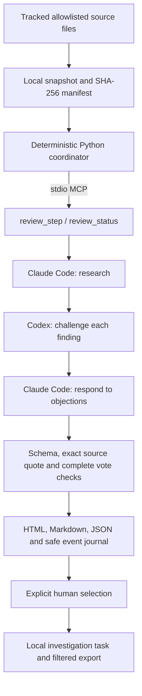

# How this portfolio is developed

The local review orchestrator asks Claude Code to research a bounded source snapshot,
asks Codex to challenge its findings, then asks Claude to respond. A deterministic
controller keeps the sequence and evidence checks outside either model. A person
selects proposals for investigation in beads.

This is development tooling for the six-project portfolio, not part of the
JWT-SVID token endpoint or the deployed Kubernetes lab. Its first implementation
is tracked by `svid-6g7`. It demonstrates review provenance and explicit authority
boundaries, not production readiness or the correctness of model consensus.

## Architecture



The exposed MCP tools accept project and stage names. They do not accept arbitrary
commands, filesystem paths or free-form prompts. No MCP tool edits source or creates
tasks. `accept` is a separate operator command, not an agent tool.

The controller uses the repository's existing MCP Python 2.x dependency and both
installed CLIs. It does not require an additional OpenAI API key or an LLM supervisor.
Provider authentication uses the existing CLI login. Provider usage can consume the
operator's plan allowance or configured billing; subprocess timeouts are not spending caps.

The [original OpenAI Agents SDK cookbook][cookbook] is now explicitly archived:
`codex mcp-server` is deprecated. This implementation exposes its own narrow MCP
server and calls `codex exec`; it does not revive that deprecated endpoint or claim
to implement the OpenAI Agents SDK. The [Codex SDK][codex-sdk] is an alternative
adapter path if richer session control is needed later. Claude uses its documented
[programmatic CLI interface][claude-cli]. Local CLI flags were inspected for Codex
0.160.0 and Claude Code 2.1.270 on 2026-10-07.

## Run it

From the `mcp-svid-auth` checkout:

```sh
# Real stdio MCP, deterministic fixture responses, no provider calls:
uv run --locked python -m scripts.quorum demo

# Real Claude/Codex/Claude calls on a tiny synthetic snippet, not a portfolio review:
uv run --locked python -m scripts.quorum smoke --live --timeout 120

# Prepare the six sibling projects locally. Inspect the packet files first:
uv run --locked python -m scripts.quorum prepare

# Substitute the run ID printed by prepare. Requires both existing CLI logins:
uv run --locked python -m scripts.quorum run --run RUN_ID --live

# Regenerate the report without asking a model:
uv run --locked python -m scripts.quorum report --run RUN_ID --live

# After independently reviewing a consensus proposal, explicitly select it:
uv run --locked python -m scripts.quorum accept --run RUN_ID --live \
  --project hipaa-fhir-mcp --finding F1
```

`--project` can select one project for `prepare` or `demo`. `--timeout` bounds each
provider subprocess to 1-900 seconds, default 300. A failed stage leaves the run
incomplete and writes a fixed error code. Repeating `run` resumes missing stages;
completed stages are not charged again. Interrupted runs may retain `.active` after
an uncatchable process kill. Confirm no coordinator is running before removing that
empty lock directory. Never run two controllers against the same run directory.

If a CLI is missing or logged out, authenticate in its own terminal using its
normal login flow. Do not paste credentials into a prompt or a report. There is no
automatic installation, login, provider fallback or permission bypass.

The local MCP server can also be attached explicitly to an MCP client:

```sh
uv run --locked python -m scripts.quorum serve --run RUN_ID --live
```

Use an absolute working directory pointing to this checkout in the client's stdio
configuration. Starting the live server authorizes paid provider calls through its
review tools. No global Codex or Claude configuration is modified automatically.

## Evidence and the meaning of quorum

Each finding needs a stable ID, priority, exact source line and quote, proposed
improvement, acceptance check, and any public source URLs. The verifier and rebuttal
must each address every original finding exactly once. Additional findings require
a new research cycle. Their verdicts are `support`, `dispute` or `needs_test`.

Two supporting votes yield `consensus_proposal`, never `verified` or `approved`.
A dispute or a request for a test yields `unresolved`. Missing stages yield `pending`.
Exact quotation checks only establish correspondence to the frozen packet; they
do not prove causality, runtime behavior, severity, or the validity of a web source.
The controller does not fetch and independently verify provider citations.

The `provider-smoke` mode calls both real providers on synthetic input. It proves
the adapter chain only. Its findings cannot be promoted to beads, and its report
must not be presented as research into the portfolio.

`accept` creates an **investigation** task that requires independent reproduction.
It preserves source provenance, avoids repeating the same proposal through an
external reference, runs beads with `--sandbox`, excludes `personal` issues and
removes `owner` on export. It does not automatically merge semantically similar
existing tasks; inspect the existing backlog before selection. Existing issues and
unresolved findings are not silently closed. If task creation succeeds but export
fails, rerun selection after fixing the export; the external reference avoids a
duplicate task.

## What leaves the machine

`prepare`, `report` and `demo` do not call a model. `run --live` sends the prepared
source content and bounded prior reviews to the selected providers. New runs use
`research_mode: source_only`: Claude has an empty tool allowlist and reviews at
most one concrete finding. Current public documentation is checked separately by
the coordinator. Legacy manifests without this mode retain their web-tool behavior.

Each registered project now has an explicit focused source allowlist in
`scripts/quorum_core.py`: authorization/policy, FHIR configuration/security stubs,
bridge credential lifecycle, ECS resolution/sync, CISO assessment/HTTP, and the
Engineering OS tracker model/store. This is one bounded question per project,
not complete codebase coverage. Untracked files, vaults, private configuration,
symlinks escaping the checkout and credential-shaped content stay excluded.
Limits remain 100 files, 60,000 bytes per file and 180,000 source characters.
`omitted` lists rejected selected files, not every file outside the allowlist.
Source hashes, HEAD and dirty status describe the reviewed working-tree snapshot.

See [the Engineering OS integration review](engineering-os-integration.md) and
[the six-project review](portfolio-quorum-2026-10-07.md) for coverage and results.

Claude runs with safe mode and an empty explicit MCP configuration. Source-only
runs disable all its tools. Codex runs in a temporary directory with user
configuration ignored, a read-only sandbox, shell tool disabled and no approval
escalation. Neither CLI receives a repository checkout as its working directory.
Claude Code 2.1.231 does not accept `--restricted`; the adapter uses the explicit
tool allowlist and safe mode without that version-specific flag.
These CLI controls are not a separately verified host filesystem isolation layer.
The operating system and provider CLI remain trusted. This does not attest either
reviewer with SPIRE and does not use short-lived SVID tokens for provider login.

All repository and web content and other-agent output are untrusted evidence.
Prompt instructions alone are insufficient protection; the deterministic boundary
checks output schemas, source quotes, project names and stage order. Reports escape
HTML and use a restrictive content policy. No generated code or model-proposed
command is executed. No raw provider stderr or session stream is copied into the
event journal. Provider processes and descendants are killed on timeout/cancellation.

## Development artifacts

Runs stay in ignored `var/quorum/RUN_ID/`:

| File | Purpose |
|---|---|
| `manifest.json` | Mode, CLI versions, packet hashes and coordinator source hashes for new runs |
| `PROJECT/packet.json` | Frozen selected source and omissions |
| `PROJECT/research.json` | Claude findings and research links |
| `PROJECT/verify.json` | Codex votes and objections |
| `PROJECT/rebuttal.json` | Claude response to each finding |
| `events.jsonl` | Stage starts, completions and safe failures |
| `index.html` | Local presentation overview |
| `report.md`, `report.json` | Full findings, votes, evidence and limitations |

The journal and hashes are local provenance, not tamper-proof archival signatures.
They do not protect against someone who can rewrite the whole run directory.
Raw packets and provider reviews stay ignored. Share only an inspected export.
The checked-in [synthetic demonstration](quorum-demo/index.html) is
explicitly labeled; it must not be presented as a model review of these projects.

The [real-provider smoke record](quorum-provider-smoke/index.html) captures an
actual Claude / Codex / Claude cycle on the same tiny synthetic source. Its
separate [event journal](quorum-provider-smoke/events.jsonl) records the three
completed calls. This demonstrates the orchestration, not a completed portfolio audit.

Tests cover fabricated evidence, missing/duplicate votes, out-of-order stages,
snapshot changes, disputes, mode confusion, concurrent writers, process failure,
timeout, output bounds, source exclusions, privacy, HTML escaping and the actual
stdio MCP lifecycle. `make check` includes them. Runtime changes to the security
lab are outside this increment.

[cookbook]: https://developers.openai.com/cookbook/examples/codex/codex_mcp_agents_sdk/building_consistent_workflows_codex_cli_agents_sdk
[codex-sdk]: https://learn.chatgpt.com/docs/codex-sdk
[claude-cli]: https://code.claude.com/docs/en/headless

The [validation record](quorum-validation.md) separates passed checks, real-provider smoke evidence and incomplete portfolio research.


## Kimi across the portfolio

New live runs require Kimi for every selected project, including all six projects
when preparing the default portfolio. The controller runs Claude research, Codex
challenge, Claude rebuttal and Kimi for each project. Missing or rejected Kimi
votes keep completion and proposal promotion blocked. A project failure is
recorded without stopping independent projects.

An existing completed live run can receive an additional source-grounded peer
vote through the Moonshot API. This sends the selected source packet and prior
reviews to Moonshot only with `--live`. It does not repeat Claude or Codex calls.

```sh
# Provide MOONSHOT_API_KEY or KIMI_API_KEY through the local environment.
# Never paste a key into a prompt, command argument or tracked file.
uv run --locked python -m scripts.quorum_kimi \
  --run RUN_ID --project all --live
```

The adapter uses `kimi-k2.6` at the fixed HTTPS Moonshot endpoint. Each invocation
makes at most one request, with no retries, redirects, tools or environment
proxies. Limits: 300,000 UTF-8 prompt bytes, 8,192 output tokens with thinking disabled, 250,000 response bytes and a 180-second total timeout. These are
request bounds, not a guaranteed monetary cap; input and output are billable.
A transport failure may still incur provider usage; rerun deliberately.

Only the validated final review, model, usage counters, timestamp and prompt/code
hashes are stored in `kimi.json`. Reasoning text, API keys and raw API errors are
not persisted. Schema failures retain only safe validation categories and usage
in `kimi-failure.json`. An existing successful peer review is reused without another call.
Kimi can prevent consensus by disputing a proposal, but cannot override an
existing Claude/Codex disagreement. No majority vote approves code or publication.

The same schema and exact-line evidence checks apply. Reports show Kimi's vote
separately. New manifests declare `required_peers: ["kimi"]`; reports expose both
`base_complete` for the original three stages and `complete` for the full review.
Legacy manifests retain their original completion semantics. The Kimi batch
command defaults to all projects in the selected manifest, makes at most one
request per eligible project and preserves per-project failures and completed
results. An incomplete original review is reported without calling Kimi.

Implementation references, checked 2026-10-07:
[Moonshot JSON mode](https://platform.kimi.ai/docs/guide/use-json-mode-feature-of-kimi-api)
and [thinking/output limits](https://platform.kimi.ai/docs/guide/use-thinking-models).
